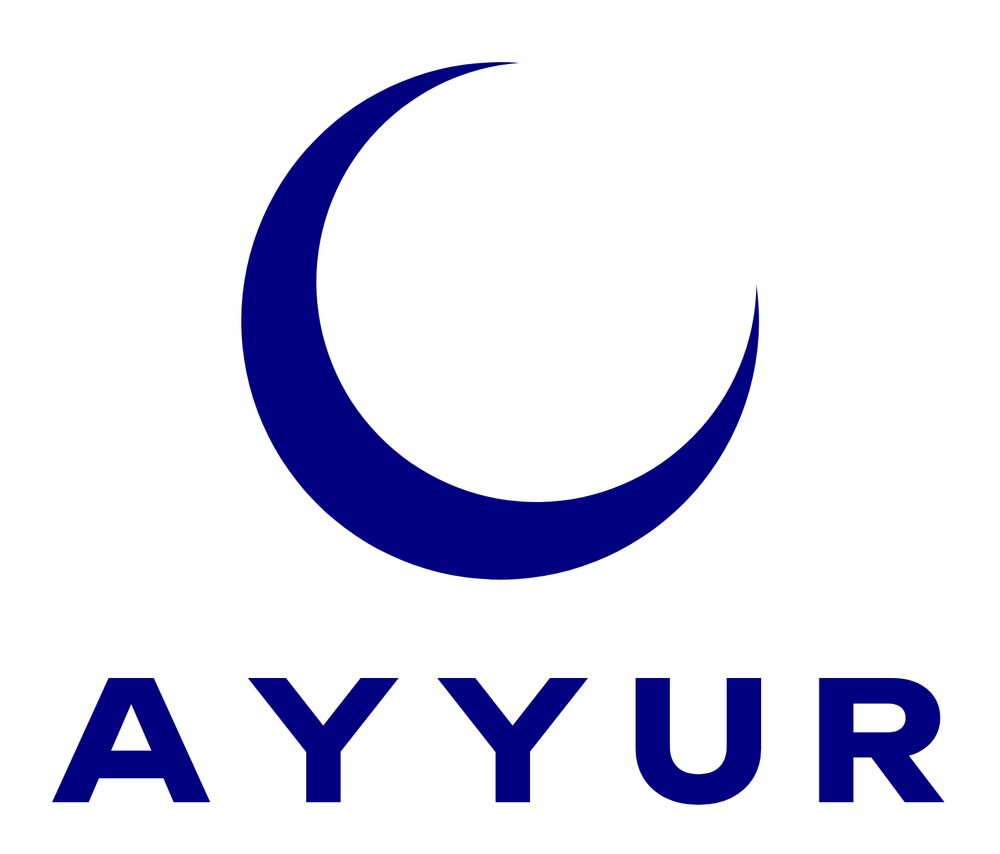
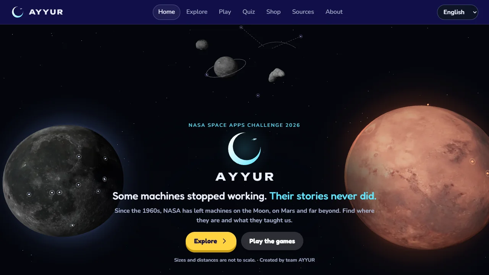
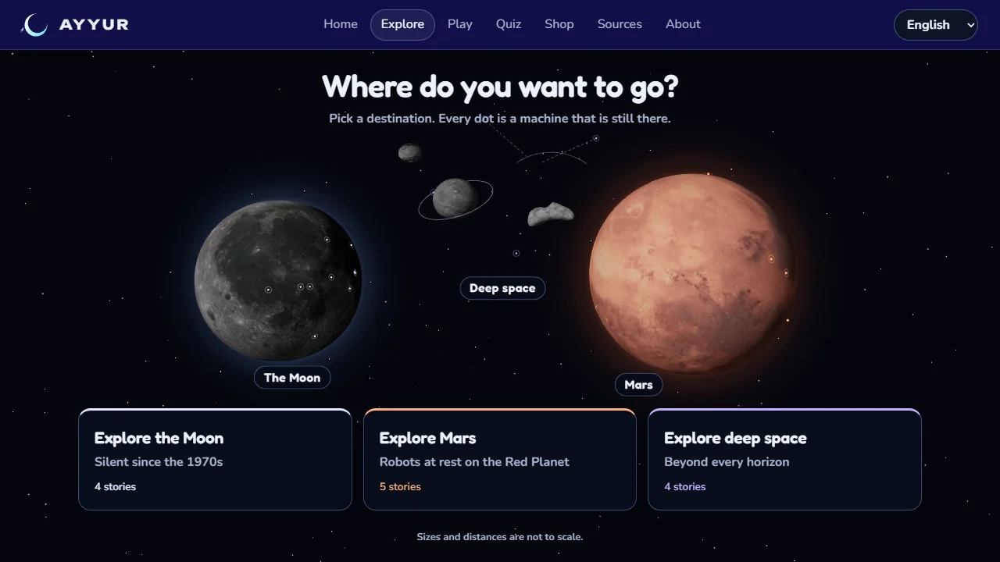
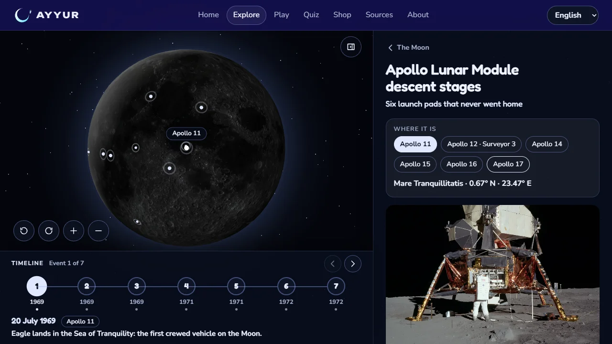
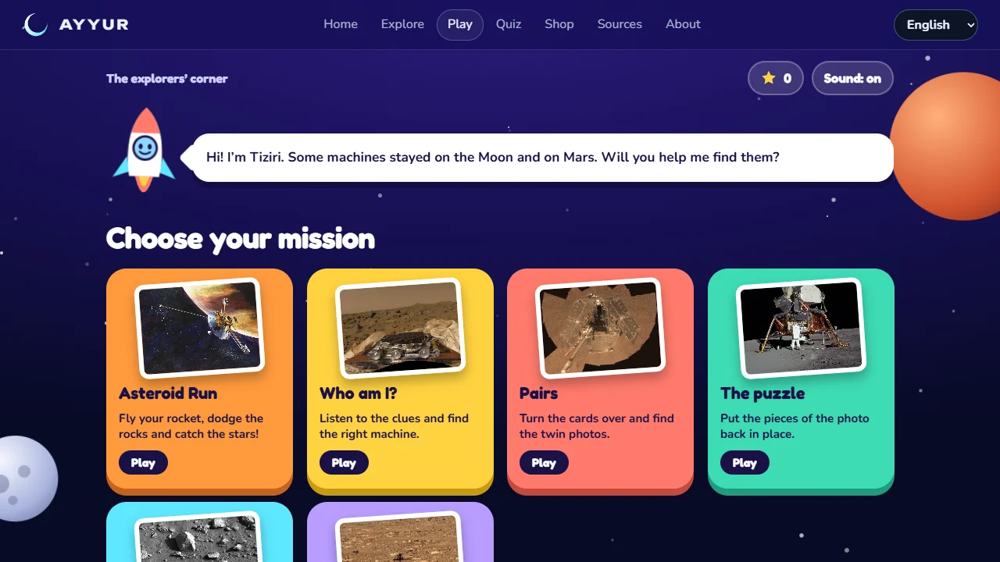
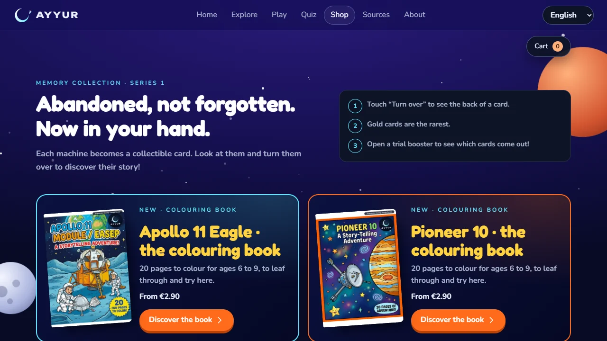
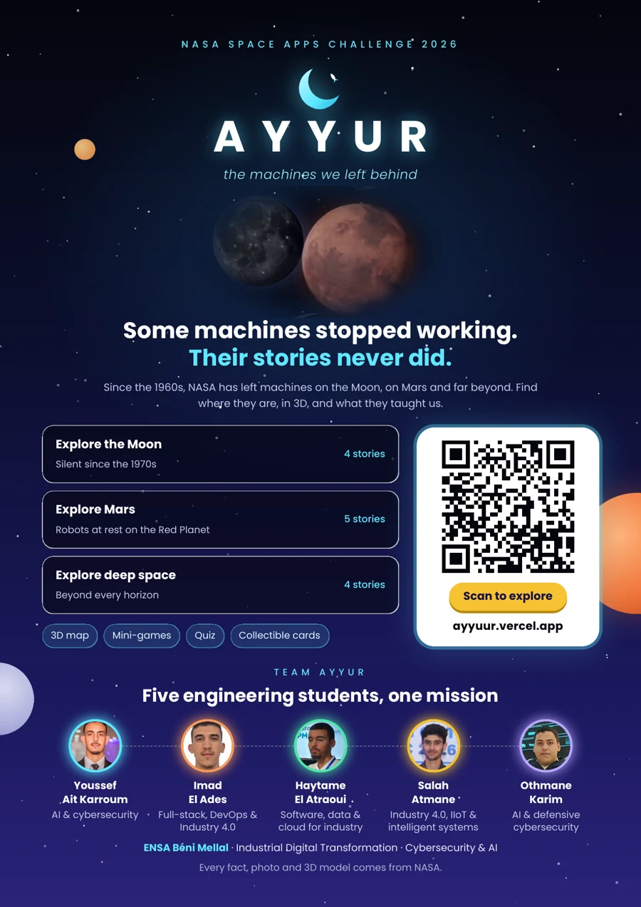

<a id="readme-top"></a>

<!-- PROJECT SHIELDS -->
<div align="center">

[![NASA Space Apps 2026][spaceapps-shield]][spaceapps-url]
[![Live site][live-shield]][live-url]
[![Languages][lang-shield]](#usage)

</div>

<!-- PROJECT LOGO -->
<br />
<div align="center">
  <a href="https://ayyuur.vercel.app">
    <picture>
      <source media="(prefers-color-scheme: dark)" srcset="assets/brand/ayyur-logo-clair-sur-sombre.png">
      
    </picture>
  </a>

  <h3 align="center">AYYUR · the machines we left behind</h3>

  <p align="center">
    Some machines stopped working. <b>Their stories never did.</b>
    <br />
    An interactive 3D museum of the machines NASA left on the Moon, on Mars and in deep space.
    <br />
    NASA Space Apps Challenge 2026 · <i>Abandoned but not Forgotten</i>
    <br />
    <br />
    <a href="https://ayyuur.vercel.app"><strong>Open the live site »</strong></a>
    <br />
    <br />
    <a href="#demo-video">Watch the demo</a>
    &middot;
    <a href="https://github.com/Haytame37/space-apps-2026/issues/new?template=bug-report.md">Report a bug</a>
    &middot;
    <a href="https://github.com/Haytame37/space-apps-2026/issues/new?template=feature-request.md">Request a feature</a>
  </p>
</div>

<!-- TABLE OF CONTENTS -->
<details>
  <summary>Table of contents</summary>
  <ol>
    <li>
      <a href="#about-the-project">About the project</a>
      <ul>
        <li><a href="#demo-video">Demo video</a></li>
        <li><a href="#features">Features</a></li>
        <li><a href="#built-with">Built with</a></li>
      </ul>
    </li>
    <li>
      <a href="#getting-started">Getting started</a>
      <ul>
        <li><a href="#prerequisites">Prerequisites</a></li>
        <li><a href="#installation">Installation</a></li>
      </ul>
    </li>
    <li><a href="#usage">Usage</a></li>
    <li><a href="#project-structure">Project structure</a></li>
    <li><a href="#deployment">Deployment</a></li>
    <li><a href="#pitch">Pitch</a></li>
    <li><a href="#roadmap">Roadmap</a></li>
    <li><a href="#contributing">Contributing</a></li>
    <li><a href="#license">License</a></li>
    <li><a href="#team">Team</a></li>
    <li><a href="#acknowledgments">Acknowledgments</a></li>
  </ol>
</details>

<!-- ABOUT THE PROJECT -->
## About the project

<div align="center">
  <a href="https://ayyuur.vercel.app"></a>
</div>

<br />

Since the 1960s, NASA has left machines on the Moon, on Mars and far beyond: Apollo lunar modules,
Surveyor, Viking, Spirit and Opportunity, InSight, Ingenuity, Pioneer 10 and more. The challenge asks
for storytelling about this discarded equipment. AYYUR answers it by turning "space junk" into memory:
every machine has a name, a place, a story, the reason it went quiet, and what it still teaches us.

Every fact, date, photo and 3D model comes from NASA (NSSDCA and NASA Science), and every source is
listed on the site's **Sources** page.

<p align="right">(<a href="#readme-top">back to top</a>)</p>

### Demo video

<!-- DEMO VIDEO: paste the GitHub video link (https://github.com/user-attachments/assets/...) on its own line below. -->

30-second demo (1080p): [`demo/AYYUR-demo-30s.mp4`](demo/AYYUR-demo-30s.mp4).

The full 5-minute pitch video: [`pitch/AYYUR-pitch-5min.mp4`](pitch/AYYUR-pitch-5min.mp4) (1080p, 30 fps).

<p align="right">(<a href="#readme-top">back to top</a>)</p>

### Features

| | |
|---|---|
|  | **3 destinations, 13 stories.** Spin NASA globes of the Moon, Mars, Ceres, Vesta and Eros to find where each machine rests. |
|  | **Mission timelines.** Each event flies the globe to where it happened. Inspect NASA 3D models and open NASA's Eyes on the Solar System inside the site. |
|  | **Explorers' corner.** Asteroid Run, Who am I?, Pairs, the puzzle, In order and a true-or-false quiz, built from the same NASA facts. |
|  | **Collectible cards and colouring books.** Every machine becomes a card, and two colouring books (Apollo 11, Pioneer 10) can be leafed through and coloured online. |

The whole site is available in **English, French, Spanish and Arabic** (right to left), adapts to
phones, and respects reduced motion.

<p align="right">(<a href="#readme-top">back to top</a>)</p>

### Built with

[![React][react-shield]][react-url]
[![TypeScript][ts-shield]][ts-url]
[![Three.js][three-shield]][three-url]
[![Vite][vite-shield]][vite-url]
[![Vercel][vercel-shield]][vercel-url]

3D scenes use [React Three Fiber](https://r3f.docs.pmnd.rs/) and [drei](https://drei.docs.pmnd.rs/);
routing uses [React Router](https://reactrouter.com/).

<p align="right">(<a href="#readme-top">back to top</a>)</p>

<!-- GETTING STARTED -->
## Getting started

AYYUR is a static Vite + React app. It needs no back end, database or API key.

### Prerequisites

* [Node.js](https://nodejs.org/) 20 or later, with npm

### Installation

1. Clone the repo
   ```sh
   git clone https://github.com/Haytame37/space-apps-2026.git
   cd space-apps-2026
   ```
2. Install the packages
   ```sh
   npm install
   ```
3. Start the dev server and open http://localhost:5173
   ```sh
   npm run dev
   ```

<p align="right">(<a href="#readme-top">back to top</a>)</p>

<!-- USAGE -->
## Usage

| Command | What it does |
|---|---|
| `npm run dev` | Dev server on http://localhost:5173 |
| `npm run build` | Type-check and production build in `dist/` |
| `npm run preview` | Serve `dist/` on http://localhost:4173 |
| `npm run lint` | Lint with oxlint |
| `node scripts/book-pages.mjs <book-id>` | Turn a colouring book PDF from `assets/books/` into the images in `public/books/` (`pioneer-10` or `apollo-11`) |

The language menu sits at the top right; the choice of English, French, Spanish or Arabic applies to the whole site.

<p align="right">(<a href="#readme-top">back to top</a>)</p>

<!-- PROJECT STRUCTURE -->
## Project structure

| Path | Content |
|---|---|
| `src/data/machines.ts` | Every machine, place, coordinate, date and source URL |
| `src/data/quiz.ts` | Quiz answers (questions are in the locale files) |
| `src/i18n/{en,fr,es,ar}.ts` | All texts, one file per language |
| `src/stage/Stage.tsx` | The 3D scene: globes, markers, camera flights |
| `src/components/MachinePanel.tsx` | Story, timeline, 3D model and NASA live view tabs |
| `src/components/TimelineDock.tsx` | Mission timeline under the 3D view; each event turns the globe to where it happened (`TIMELINE_PLACES` in `machines.ts`) |
| `src/components/StageViews.tsx` | Selector above the large view (globe, 3D model, NASA live view) and the switch that hides the side panel |
| `src/components/SheetPanel.tsx` | Side panel on wide screens; draggable bottom sheet on phones |
| `src/components/AyyurLogo.tsx` | Team logo: `static`, `orbit` and `intro` variants (timeline in `src/lib/ayyurMotion.ts`); `AyyurLoader.tsx` wraps it for loading screens |
| `src/games/`, `src/kids/` | Games for teens and adults, and the kids' corner (including the Asteroid Run rocket game) |
| `src/shop/`, `src/book/` | Collectible cards, cart, and the colouring books (flip-through and colouring canvas) |
| `src/styles/` | `index.css` (base and components), `interaction.css` (press feedback, user preferences), `motion.css` (entrances), `compact.css` (phone held sideways, short screens) and one file per section |
| `public/models/` | NASA glTF models, compressed with gltf-transform (meshopt + WebP) |
| `public/media/` | NASA photos from the challenge's resource pages, resized to WebP |
| `assets/books/` | Source PDFs of the colouring books |
| `assets/brand/` | AYYUR logo pack (SVG, PNG, animated GIF/MP4) and posters (`ayyur-affiche.pdf`) |
| `docs/` | Submission answers (`SUBMISSION.md`), business plan (`BUSINESS.md`) and README images |
| `demo/` | The 30-second demo video for the submission |
| `pitch/` | The 5-minute pitch video for the jury |

<p align="right">(<a href="#readme-top">back to top</a>)</p>

<!-- DEPLOYMENT -->
## Deployment

The site is deployed on Vercel; `vercel.json` already sends every route to `index.html`.

**From the Vercel website:** New Project → import this Git repository → Framework preset *Vite*
(detected automatically) → Deploy. Build command `npm run build`, output directory `dist`.

**From the terminal:**

```sh
npx vercel          # first time: log in and link the project (preview URL)
npx vercel --prod   # production URL
```

**Security headers.** `vercel.json` sends a Content-Security-Policy with every page. The only outside
origin allowed is `https://eyes.nasa.gov`, for the embedded NASA Eyes views. To embed another NASA
interactive, add its origin to `frame-src` there, or the browser will block the frame.

<p align="right">(<a href="#readme-top">back to top</a>)</p>

<!-- PITCH -->
## Pitch

| File | Content |
|---|---|
| [`demo/AYYUR-demo-30s.mp4`](demo/AYYUR-demo-30s.mp4) | 30-second demo for the submission form: English captions, ends on the live site |
| [`pitch/AYYUR-pitch-5min.mp4`](pitch/AYYUR-pitch-5min.mp4) | 5-minute pitch shown to the jury while the team presents |

Both videos are built from the same NASA facts, photos and 3D models as the site. AI use is declared: the
AYYUR logo was made with the help of AI, and the colouring-book drawings are AI-generated and marked as such.

<p align="right">(<a href="#readme-top">back to top</a>)</p>

<!-- ROADMAP -->
## Roadmap

- [x] 3D globes of the Moon, Mars and deep-space bodies with every machine placed on them
- [x] Mission timelines, NASA 3D models and NASA Eyes live views
- [x] Five mini-games and a quiz, with a kids' corner
- [x] Collectible memory cards and two colouring books
- [x] English, French, Spanish and Arabic (right to left)

See the [open issues](https://github.com/Haytame37/space-apps-2026/issues) for proposed features and known issues.

<p align="right">(<a href="#readme-top">back to top</a>)</p>

<!-- CONTRIBUTING -->
## Contributing

Contributions, corrections and new machine stories are welcome. Every fact must come with a NASA source.

1. Fork the project
2. Create your feature branch (`git checkout -b feature/new-machine`)
3. Commit your changes (`git commit -m "feat: add the Luna 9 story"`)
4. Push to the branch (`git push origin feature/new-machine`)
5. Open a pull request

<p align="right">(<a href="#readme-top">back to top</a>)</p>

<!-- LICENSE -->
## License

No license has been chosen yet: the code is © team AYYUR, all rights reserved. NASA photos, models and
data are used under the [NASA media usage guidelines](https://www.nasa.gov/nasa-brand-center/images-and-media/).

<p align="right">(<a href="#readme-top">back to top</a>)</p>

<!-- TEAM -->
## Team

<div align="center">
  
</div>

<br />

Five engineering students from **ENSA Béni Mellal** (Industrial Digital Transformation · Cybersecurity & AI).

| Member | Focus | Links |
|---|---|---|
| **Youssef Ait Karroum** | AI & cybersecurity | [GitHub](https://github.com/YOUSSEFKARROUM) · [LinkedIn](https://ma.linkedin.com/in/youssef-ait-karroum-579304268) · [Portfolio](https://youssefkarroum.github.io/portfolio/) |
| **Imad El Ades** | Full-stack, DevOps & Industry 4.0 | [GitHub](https://github.com/imad-elades) · [LinkedIn](https://www.linkedin.com/in/imad-elades/) · [Portfolio](https://imadelades.vercel.app/) |
| **Haytame El Atraoui** | Software, data & cloud for industry | [GitHub](https://github.com/Haytame37) · [LinkedIn](https://www.linkedin.com/in/haytame-el-atraoui) · [Portfolio](https://haytame37.github.io/) |
| **Salah Atmane** | Industry 4.0, IIoT & intelligent systems | [GitHub](https://github.com/SalahAT-CREAT) · [LinkedIn](https://www.linkedin.com/in/salah-atmane/) · [Portfolio](https://salahat-creat.github.io/portfolio/) |
| **Othmane Karim** | AI & defensive cybersecurity | [GitHub](https://github.com/Galdro-0) · [LinkedIn](https://www.linkedin.com/in/othmane-karim/) · [Portfolio](https://galdro-0.github.io/) |

Project link: [https://github.com/Haytame37/space-apps-2026](https://github.com/Haytame37/space-apps-2026)

<p align="right">(<a href="#readme-top">back to top</a>)</p>

<!-- ACKNOWLEDGMENTS -->
## Acknowledgments

* [NASA Space Apps Challenge 2026](https://www.spaceappschallenge.org/2026/challenges/nasas-discarded-equipment-storytelling/) and its Resources tab
* [NSSDCA](https://nssdc.gsfc.nasa.gov/) and [NASA Science](https://science.nasa.gov/) mission pages, for every fact, photo and model
* [NASA's Eyes on the Solar System](https://eyes.nasa.gov/), embedded in the site
* [Best-README-Template](https://github.com/othneildrew/Best-README-Template), the structure of this README

**AI disclosure.** An AI assistant (Claude) helped write the code and draft and translate the texts.
The team's animated logo (the AYYUR crescent, its orbiting ship and the name) was also created with
the help of an AI assistant; it is drawn in code (SVG) and uses no NASA imagery. The line drawings of
the colouring books (Pioneer 10, Apollo 11) were generated with Google Gemini, then chosen, checked and
laid out by the team; they are marked "AI-generated" on the site. Apart from the logo and those
drawings, no image, video, model or audio was generated by AI.

<p align="right">(<a href="#readme-top">back to top</a>)</p>

<!-- MARKDOWN LINKS & IMAGES -->
[spaceapps-shield]: https://img.shields.io/badge/NASA%20Space%20Apps-2026-0B3D91?style=for-the-badge&logo=nasa&logoColor=white
[spaceapps-url]: https://www.spaceappschallenge.org/2026/challenges/nasas-discarded-equipment-storytelling/
[live-shield]: https://img.shields.io/badge/live-ayyuur.vercel.app-5EE7FF?style=for-the-badge&logo=vercel&logoColor=black
[live-url]: https://ayyuur.vercel.app
[lang-shield]: https://img.shields.io/badge/languages-EN%20·%20FR%20·%20ES%20·%20AR-FFD77A?style=for-the-badge
[react-shield]: https://img.shields.io/badge/React%2019-20232A?style=for-the-badge&logo=react&logoColor=61DAFB
[react-url]: https://react.dev/
[ts-shield]: https://img.shields.io/badge/TypeScript-3178C6?style=for-the-badge&logo=typescript&logoColor=white
[ts-url]: https://www.typescriptlang.org/
[three-shield]: https://img.shields.io/badge/Three.js-000000?style=for-the-badge&logo=threedotjs&logoColor=white
[three-url]: https://threejs.org/
[vite-shield]: https://img.shields.io/badge/Vite-646CFF?style=for-the-badge&logo=vite&logoColor=white
[vite-url]: https://vite.dev/
[vercel-shield]: https://img.shields.io/badge/Vercel-000000?style=for-the-badge&logo=vercel&logoColor=white
[vercel-url]: https://vercel.com/
